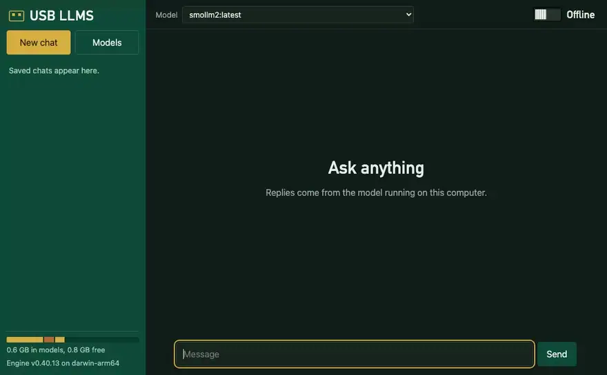
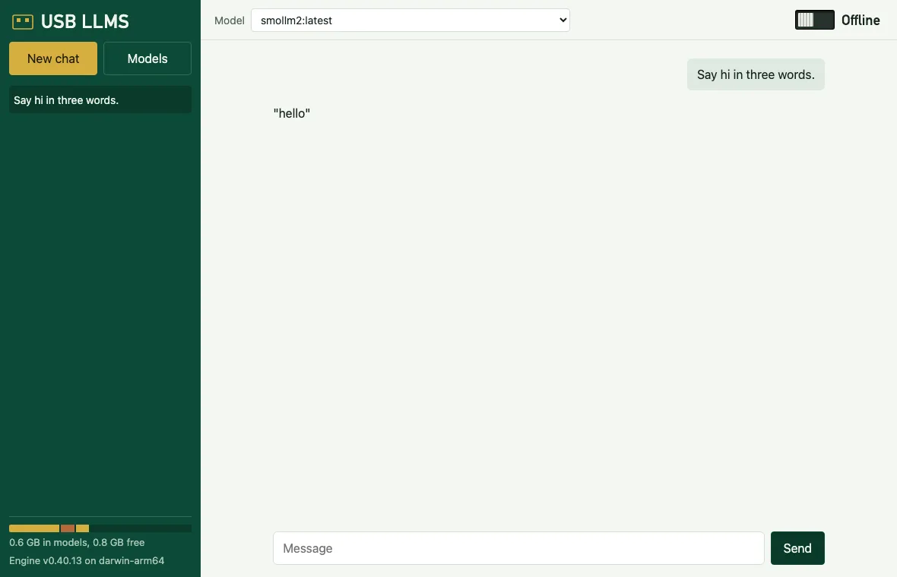
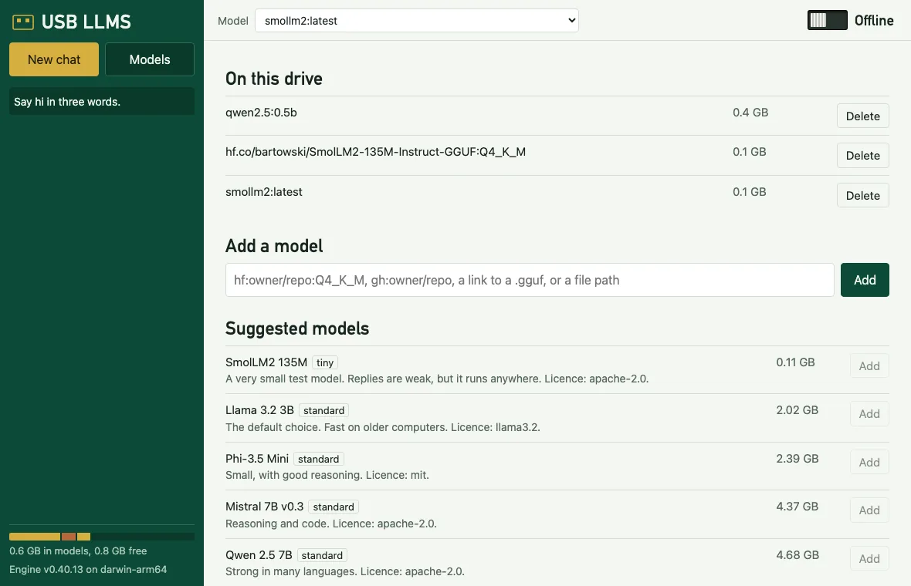
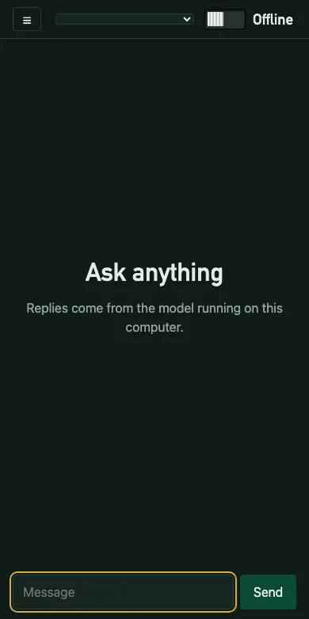

<div align="center">

# USB LLMS

Run AI models from a USB stick on macOS, Windows and Linux, with or without the internet.

[Start](#start) · [Interfaces](#interfaces) · [Models](#models) · [Media](#media) · [Offline and online](#offline-and-online) · [LvW-harness](#lvw-harness) · [Limits](#limits)

   



</div>

USB LLMS is one small program plus a folder. Put the folder on a stick, and the same models and chats work on every computer you plug it into. It also makes pictures, short videos, speech, music and 3D models from the stick, and the chat takes pictures and voice notes. Nothing is installed on the computer, and your own Ollama keeps running undisturbed.

It replaces two deprecated projects, [USB-Uncensored-LLM](https://github.com/techjarves/USB-Uncensored-LLM) and [Portable-AI-USB](https://github.com/techjarves/Portable-AI-USB), with a single tool written from scratch. See [NOTICE](NOTICE.md).

<!-- live-links -->
**Project page:** [gitguy268.github.io/usb-llms](https://gitguy268.github.io/usb-llms/) · [usb-llms.vercel.app](https://usb-llms.vercel.app)
<!-- /live-links -->

## Install with Homebrew

```sh
brew trust gitguy268/tap
brew install gitguy268/tap/usb-llms
```

<!-- run-steps:start -->
## Run it locally, step by step

1. **Install [Go](https://go.dev/dl/) 1.24** or newer.

2. **Get the code:**

   ```sh
   git clone https://github.com/Gitguy268/usb-llms.git
   cd usb-llms
   ```

3. **Build it:**

   ```sh
   go build -o usb-llms .
   ```

4. **Set it up while online,** with a small first model:

   ```sh
   ./usb-llms --home ./drive setup --lean --model smollm2-135m
   ```

5. **Open the menu:** double-click `start.command` on macOS or `start.bat` on Windows, or run `sh start.sh` on Linux.
<!-- run-steps:end -->

## Start

1. Format the stick as **exFAT**, so all three systems can use it. Plan for at least 16 GB.
2. Copy the release folder onto it.
3. While online, open the launcher for your system and choose **Set up this computer**:

| System | Open this |
|---|---|
| macOS | double-click `start.command` |
| Windows | double-click `start.bat` |
| Linux | `sh start.sh` |

Each computer type needs its engine once. Models are shared between all of them.

Or from a terminal:

```sh
usb-llms setup --model llama-3.2-3b     # engine for this computer, plus a first model
usb-llms run hf.co/bartowski/Llama-3.2-3B-Instruct-GGUF:Q4_K_M
```

<details>
<summary>What goes where on the drive</summary>

```
USB LLMS/
  start.command  start.sh  start.bat     pick the right program for this computer
  bin/                                   usb-llms for each system
  engine/<system>/                       Ollama, added per system on demand
  models/                                every chat and audio model, shared by all systems
  media/                                 image and video weights, shared by all systems
  data/                                  settings, chats, logs and engine state
  data/media/                            what you made, and files attached in chat
  data/sidecar/                          the 3D and music engines: shared weights, a Python env per system
```

Stop the engine before you eject the stick. The terminal interface, `web`, `app`, `webui` and `lvw` stop an engine they started when you quit them. After `usb-llms run`, `pull`, `start` or similar commands, run `usb-llms stop`.

The program finds the folder from its own location, so the drive letter or mount point doesn't matter. Pass `--home DIR` to use another folder.

</details>

<details>
<summary>How much room the engine takes</summary>

`setup` picks **lean** unless it finds an NVIDIA or AMD GPU. Lean leaves out those GPU libraries and still uses Metal, Vulkan and the CPU. Force a choice with `--lean` or `--full`.

| System | Lean | Full |
|---|---|---|
| macOS (on exFAT) | about 580 MB | the same |
| Linux arm64 | about 65 MB | about 2.3 GB |

Linux and macOS engines are unpacked while they download, so the archive never lands on the drive. Windows needs its 1.6 GB zip on the drive during setup.

</details>

## Interfaces

| Interface | Command | What you get |
|---|---|---|
| **Terminal** | `usb-llms` | menus for chat, models, mode and everything below |
| **Web** | `usb-llms web` | chat with pictures and voice notes, saved chats, a Create page and a model manager in your browser. Works with no internet |
| **App window** | `usb-llms app` | the same page in its own window, like Ollama's desktop app |
| **Ollama commands** | `usb-llms run`, `list`, `ps`, `show`, `rm`, `cp`, `create` | the real Ollama commands, run against this drive |
| **Ollama API** | `usb-llms serve` | Ollama's API on `127.0.0.1:11435`, for any tool that speaks it |
| **Open WebUI** | `usb-llms webui install`, then `webui start` | the full [Open WebUI](https://github.com/open-webui/open-webui), unmodified, kept on the drive |

<table>
<tr>
<td></td>
<td></td>
<td width="170"></td>
</tr>
</table>

```
USB LLMS  offline  darwin-arm64

> Chat
  Models on this drive
  Add a model
  Switch to online
  Open the web interface
  Open the app window
  Open Open WebUI
  Run LvW-harness
  Quit
```

The app window needs Chrome, Edge, Brave or Chromium on the computer, and falls back to a normal browser tab. Its temporary browser profile is deleted when the window closes.

To reach the chat from your phone, run `usb-llms web --lan`. It prints a link and a QR code with a one-time token. The connection isn't encrypted, so use it only on a network you trust.

## Models

```sh
usb-llms catalog                                        # suggested models
usb-llms pull llama-3.2-3b                              # by catalogue id
usb-llms pull hf:bartowski/Phi-3.5-mini-instruct-GGUF:Q4_K_M
usb-llms pull gh:modelmaker/aimodel1                    # GitHub release, or Git LFS files in the repo
usb-llms pull gh:modelmaker/aimodel1@v2:Q4_K_M --name mine
usb-llms pull https://example.com/model.gguf
usb-llms pull ./model.gguf
usb-llms pull llama3.2                                  # the Ollama library
usb-llms rm mine
```

The `hf:` and `gh:` forms match [LvW-harness](https://github.com/Gitguy268/LvW-harness), and full `huggingface.co` and `github.com` links work too. Only GGUF models run. Set `HF_TOKEN` or `GITHUB_TOKEN` for gated or private models and for GitHub's rate limit.

<details>
<summary>The catalogue</summary>

| Id | Size | RAM | Label | Licence |
|---|---|---|---|---|
| `smollm2-135m` | 0.11 GB | 1 GB | tiny | Apache-2.0 |
| `llama-3.2-3b` (default) | 2.02 GB | 4 GB | standard | Llama 3.2 |
| `phi-3.5-mini` | 2.39 GB | 6 GB | standard | MIT |
| `mistral-7b` | 4.37 GB | 8 GB | standard | Apache-2.0 |
| `qwen2.5-7b` | 4.68 GB | 8 GB | standard | Apache-2.0 |
| `gemma2-2b-abliterated` | 1.71 GB | 4 GB | uncensored | Gemma |
| `dolphin-8b` | 4.92 GB | 8 GB | uncensored | Llama 3.1 |
| `qwen3.5-9b-uncensored` | 5.63 GB | 12 GB | uncensored | Apache-2.0 |
| `nemomix-12b` | 7.48 GB | 16 GB | uncensored | not stated |

Models labelled uncensored have had safety refusals removed, and can produce harmful or false text. USB LLMS adds no system prompt to any model. Each model's own licence applies.

</details>

## Media

Each kind has a small default model that lives on the drive next to the chat models. Set a kind up once while online, and it works offline on every computer of the same kind afterwards.

```sh
usb-llms media install speech          # LFM3 Audio (1.7 GB) in the drive's engine
usb-llms make speech "Dinner is ready." --voice female-american-english
usb-llms transcribe meeting.wav
usb-llms media install image           # stable-diffusion.cpp plus Z-Image-Turbo (6 GB)
usb-llms make image "a lighthouse on a rocky coast, watercolor"
usb-llms make 3d "a small toy robot"   # draws it first, then builds a GLB mesh
usb-llms media ls
```

| Kind | Engine on the drive | Default model | Licence |
|---|---|---|---|
| Image (text to image, picture editing) | [stable-diffusion.cpp](https://github.com/leejet/stable-diffusion.cpp) `sd-server`, added per system | Z-Image-Turbo Q3_K (6 GB). SD 1.5 (1.6 GB) is a smaller option | Apache-2.0 |
| Video (text to video, picture to video) | the same `sd-server` | Wan 2.1 T2V 1.3B (6 GB) | Apache-2.0 |
| Speech and transcription | the drive's Ollama | `lfm3-audio` (1.7 GB, 18 languages). `phonon` is a tiny English voice for Apple silicon | LFM Open 1.0 |
| Pictures and voice notes in chat | the drive's Ollama | any model that sees or hears, such as `lfm3-omni` | the model's own |
| 3D (picture to 3D, text to 3D) | [TripoSR](https://github.com/VAST-AI-Research/TripoSR) in a Python env made with uv | TripoSR (1.7 GB) | MIT |
| Music and sound | [ACE-Step 1.5](https://github.com/ace-step/ACE-Step-1.5) in a Python env made with uv | ACE-Step 1.5 2B turbo (about 9 GB) | MIT |

- **Chat** takes pictures and voice notes: attach, paste, drop or record them. A model that hears gets the audio itself. For any other model, the audio is transcribed first. Attached files are kept in `data/media/uploads`, and the saved chat only refers to them.
- **Create page** in the web interface: pick a kind, write a prompt or add a file, watch the steps and a live preview, and keep everything in a gallery. 3D models open in a viewer you can turn. Replies in chat have a 🔊 button that reads them aloud.
- **The terminal menu** has a Create entry that asks what to make, step by step.
- Results go to `data/media/<date>/`, each with a `.json` beside it holding the prompt, model, seed and settings.
- In online mode, a remote can stand in for kinds the drive can't make: `usb-llms remote add openai https://api.openai.com/v1 OPENAI_API_KEY`, then `usb-llms media api openai image=gpt-image-1 speech=tts-1 voice=alloy transcribe=whisper-1`. Offline mode never uses it.

<details>
<summary>Where each kind runs</summary>

| | macOS arm64 | macOS x64 | Linux x64 | Linux arm64 | Windows x64 | Windows arm64 |
|---|---|---|---|---|---|---|
| Image and video | yes | yes | yes (CPU, or `USB_LLMS_SD_VARIANT=vulkan`) | remote only | yes (CPU, or `vulkan` / `cuda12`) | remote only |
| Speech, transcription, voice notes | yes | yes | yes | yes | yes | yes |
| 3D and music | yes (Apple GPU) | no (no PyTorch builds) | yes | yes | yes | no |

Engines start on demand: `sd-server` on port 11438, 3D on 11439, music on 11440. `usb-llms media stop` stops them, and the terminal, web and app interfaces stop the chat engine as before. Image and video weights are shared by every system; the 3D and music engines need one install per system (a few GB each, because of PyTorch).
</details>

## Offline and online

```sh
usb-llms mode offline    # the default once a model is on the drive
usb-llms mode online
```

**Offline** blocks every outside connection: USB LLMS's own requests are refused, Ollama's cloud features are off, and the engine, Open WebUI and LvW-harness get a dead proxy address.

**Online** allows model and engine downloads, plus remote OpenAI-compatible services:

```sh
export OPENROUTER_API_KEY=...
usb-llms remote add openrouter https://openrouter.ai/api/v1 OPENROUTER_API_KEY
```

Only the variable's *name* is saved, so a lost stick can't leak your key. A key is never sent over plain `http` to another machine.

The engine's home folder and temp files stay on the drive, so it leaves no files on the computer.

## LvW-harness

[LvW-harness](https://github.com/Gitguy268/LvW-harness) is an agent that can edit files and run commands. USB LLMS can carry it and point it at the drive's models.

```sh
usb-llms lvw install /path/to/lvw       # copies the program onto the drive (about 78 MB)
usb-llms lvw run "Summarize this folder"
```

Its settings stay in `data/lvw` on the drive, and the engine address updates itself if the port changes. Offline mode applies to it too. Models without tool support, such as SmolLM2, can chat but can't use its tools. For agent work, use a tool-capable model of 3B or larger, because tiny ones call tools badly.

## Limits

What has and hasn't been tested, as of version 0.1.0:

| Tested for real | How |
|---|---|
| macOS on Apple silicon | a simulated exFAT disk image: engine setup, chat on the GPU |
| Downloads | live pulls from Hugging Face and the Ollama library, and from GitHub repo files. GitHub release assets were tested against a mock only |
| Offline mode | replies with outside network blocked by the OS, refused pulls, and no files left in the host's home or temp folders |
| Web, app window and terminal interfaces | a browser test, a headless window lifecycle test and a pseudo-terminal test, each with a real model reply |
| Open WebUI | a full install on exFAT (3.5 GB), a clean first start with outside network blocked, its page loading in a browser, and a chat through it |
| LvW-harness | run from the drive with a real reply. A tool call reached the harness and came back, but the 0.5B test model sent empty arguments, so useful tool work with a small local model is unproven |

| Not tested | Note |
|---|---|
| **Windows** | builds, and has a CI job, but has never been run. Expect rough edges in `start.bat` and in stopping the engine |
| **Linux** | builds, and has a CI job. Its lean filter was checked against the real archive listing, but it hasn't been run |
| **A real USB stick** | only an exFAT disk image. Real sticks are slower, and first starts can take minutes |
| **Intel Macs, NVIDIA and AMD GPUs, and Linux x64** | no such hardware was available |
| **`web --lan` from a second device** | the token rules and QR code were tested on one machine only |

Other limits:

- **The drive isn't encrypted.** See [SECURITY](SECURITY.md).
- **Offline mode isn't a firewall.** It stops programs that respect proxy settings, which includes everything USB LLMS starts. A model can't reach the network, but a tool you run through LvW-harness could ignore those settings.
- **LvW-harness browser tools** use the host's temp folder, because browsers can't keep a profile on exFAT.
- **Split GGUF files** aren't supported from GitHub or direct links. Pick a single-file version.
- **GitLab specs** aren't supported, unlike in LvW-harness. Use the file's direct link.
- **Media generation is slow without a GPU.** A 512×512 SD 1.5 picture takes about 4 minutes on a Mac's CPU. The pinned stable-diffusion.cpp renders SD 1.x models blank on Apple GPUs, so SD 1.5 runs on the CPU there. Z-Image-Turbo, the default, works on Apple GPUs (tested through LvW-harness, which uses the same engine build): about 3 minutes for a first 512×512 picture.
- **Media tested for real on macOS (Apple silicon, an APFS folder, not the exFAT image)**: speech, transcription and a voice note in chat through the drive's engine, SD 1.5 images and TripoSR picture-to-3D. Never run for real: Wan video, ACE-Step music and the remote fallback with a real key. The remote fallback has unit tests against a fake server; video only has a unit test of its request, and music has none.
- **3D** works on one object on a plain background. Landscapes and busy scenes give an error.
- **Transcription** reads WAV files; other formats need ffmpeg on the computer.
- **Unsigned programs.** macOS or Windows may warn the first time. `start.command` clears the macOS download flag for this folder.

## Build

```sh
go test ./...
sh scripts/build.sh                # every system, into bin/
sh scripts/build.sh darwin-arm64   # just one
```

See [CONTRIBUTING](CONTRIBUTING.md) for the test scripts, [SECURITY](SECURITY.md) for what is and isn't protected, and [NOTICE](NOTICE.md) for credits.

## Licence

MIT, © Lucas Van De Weerd. Ollama, Open WebUI and the models keep their own licences and are downloaded separately. USB LLMS isn't affiliated with any of the projects it uses.
